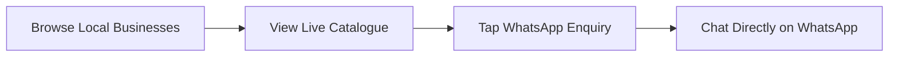

# Back2Kasi

> **One marketplace. Many businesses.**  
> Discover local township businesses, explore their products and services, and connect directly on WhatsApp.

---

## Table of Contents

1. [Overview](#overview)
2. [Sectors Supported](#sectors-supported)
3. [Key Features](#key-features)
4. [Tech Stack](#tech-stack)
5. [Project Structure](#project-structure)
6. [Local Development Setup](#local-development-setup)
7. [Running the Application](#running-the-application)
8. [Database & Migrations](#database--migrations)
9. [API Reference](#api-reference)
10. [Design System & Theme](#design-system--theme)
11. [Git Workflow](#git-workflow)

---

## Overview

**Back2Kasi** is a multi-sector township marketplace designed to empower township entrepreneurs (*Kasi businesses*) and make it effortless for community members and visitors to discover local products and services.

Rather than forcing complex in-app checkout walls or restrictive booking forms, Back2Kasi provides a frictionless, lightweight customer journey:



---

## Sectors Supported

Back2Kasi organizes businesses and offerings across 6 core township industries:

| Sector | Key | Typical Businesses |
|---|---|---|
| 💇 **Beauty & Personal Care** | `BEAUTY` | Salons, barbers, nail technicians, makeup artists |
| 🍔 **Food & Catering** | `FOOD` | Bakeries, caterers, food stalls, restaurants, shisanyama |
| 🚗 **Automotive Services** | `AUTOMOTIVE` | Mechanics, car washes, panel beaters, tyre shops |
| 🛍️ **Retail & Products** | `RETAIL` | Clothing boutiques, furniture makers, electronics, crafts |
| 🛠️ **Home & Construction** | `HOME_SERVICES` | Plumbers, electricians, painters, handymen, contractors |
| 🎪 **Events & Rentals** | `EVENTS_RENTALS` | Event decorators, sound/tent hire, cold rooms, VIP toilets |

---

## Key Features

### For Customers
- **Business-First Discovery Feed:** Browse verified local businesses filtered by industry category chips.
- **Deep Catalogue Search:** Search by business name, address, category, or specific item (e.g. typing *"fade"*, *"cake"*, or *"tyre"* surfaces businesses that offer that item).
- **Verified Kasi Business Badge:** Clear visual indicator (`is_verified = 1`) highlighting authentic, vetted township merchants.
- **Transparent Pricing:** Clear fixed prices or *"Price on Request"* tags for custom quotes.
- **Context-Aware WhatsApp Enquiries:** Tapping **Enquire** automatically opens WhatsApp with a prefilled message containing the business name and exact product/service name.

### For Business Owners
- **Merchant Dashboard:** Manage one or multiple businesses from a single account.
- **Flexible Catalogue Management:** Add and update products (goods in stock) and services (rates/consultations) with photos and pricing.
- **WhatsApp Channel Controls:** Enable or disable WhatsApp enquiry, configure South African phone numbers (`0XXXXXXXXX` validated and converted to international `27XXXXXXXXX`).
- **Availability Toggles:** Mark items as available or unavailable in real-time.

---

## Tech Stack

### Frontend (`/app`)
- **Framework:** Flutter 3.x (Dart 3.x)
- **Platforms:** Android, iOS, Windows Desktop, Web
- **State Management:** Provider
- **Design System:** Custom Back2Kasi Emerald & Charcoal palette with reusable UI components
- **Testing:** Comprehensive Flutter unit & widget test suite (`flutter test`)

### Backend (`/worker`)
- **Runtime:** Cloudflare Workers (Serverless Edge Runtime)
- **Database:** Cloudflare D1 (Distributed SQLite at edge)
- **Web Framework:** [Hono](https://hono.dev/) with TypeScript
- **Authentication:** Web Crypto API (HS256 JWT tokens)
- **Password Security:** Edge-compatible `bcryptjs`
- **Tooling:** Wrangler CLI

### Legacy Backend (`/backend`)
- *Spring Boot 3.x / Java 21 / PostgreSQL (archived for reference).*

---

## Project Structure

```
back2kasi/
├── app/                            ← Flutter cross-platform client
│   ├── lib/
│   │   ├── config/                 ← AppTheme, ApiConfig, Routing
│   │   ├── core/                   ← AuthService, BusinessProvider, RentalUnitProvider
│   │   ├── models/                 ← Business, BusinessCategory, RentalUnit
│   │   └── views/
│   │       ├── auth/               ← Login & Register screens
│   │       ├── business/           ← Merchant dashboard, business profile & catalogue
│   │       ├── customer/           ← Customer marketplace, business detail, item detail
│   │       └── shared/             ← BkButton, BkCard, BkTextField, BkEmptyState
│   └── test/                       ← Unit & widget test suites
│
├── worker/                         ← Cloudflare Worker edge REST API (Active)
│   ├── migrations/                 ← D1 SQLite migrations (0001 to 0004)
│   ├── src/
│   │   ├── index.ts                ← Routing, CORS, error handling
│   │   ├── types.ts                ← DTOs, Enums, DB models
│   │   ├── lib/                    ← JWT & error utilities
│   │   ├── middleware/             ← Auth middleware
│   │   └── routes/                 ← Auth, Businesses, Catalogue items
│   ├── package.json
│   └── wrangler.jsonc              ← Worker & D1 database bindings
│
├── backend/                        ← Original Spring Boot API (reference)
├── docs/                           ← Architecture & audit documentation
└── README.MD                       ← Project overview & guides
```

---

## Local Development Setup

### Prerequisites
- [Flutter SDK](https://docs.flutter.dev/get-started/install) (3.24+ recommended)
- [Node.js](https://nodejs.org/) (18+ recommended)
- Git

### 1. Clone the repository
```bash
git clone https://github.com/MonchoKK/back2kasi.git
cd back2kasi
```

### 2. Setup & Run the Backend API (Worker)
```bash
cd worker
npm install
npm run migrate:local
npm run dev
```
The API server starts locally at **`http://localhost:8787`**.

### 3. Setup & Launch the Flutter App
In a separate terminal:
```bash
cd app
flutter pub get
flutter run
```

> **Target specific devices:**
> - Windows: `flutter run -d windows`
> - Chrome: `flutter run -d chrome`
> - Android: `flutter run -d android`

---

## Database & Migrations

Cloudflare D1 migrations are located in `worker/migrations/`:

| Migration | Purpose |
|---|---|
| `0001_initial_schema.sql` | Users, businesses, rental units, bookings tables |
| `0002_images_and_constraints.sql` | Multi-image gallery for catalogue items |
| `0003_whatsapp_contact.sql` | Business WhatsApp number & toggle fields |
| `0004_generic_marketplace.sql` | Industry categories, `is_verified` badge, `item_type` (`PRODUCT`/`SERVICE`), `is_price_on_request`, `price_unit` |

### Apply migrations:
- **Local:** `npm --prefix worker run migrate:local`
- **Remote (Production):** `npm --prefix worker run migrate:remote`

---

## API Reference

All endpoints are hosted on the Worker (`http://localhost:8787` in dev or `https://back2kasi-api.back2kasi.workers.dev` in production).

### Authentication
- `POST /api/users/register` — Register a customer or business owner account
- `POST /api/users/login` — Sign in and obtain JWT
- `GET /api/users/me` — Get current authenticated user profile

### Businesses
- `GET /api/businesses` — List businesses (supports `?category=BEAUTY`, `?search=salon`, `?ownerId=...`)
- `GET /api/businesses/:id` — Get single business details
- `POST /api/businesses` — Register a new business *(Owner)*
- `PUT /api/businesses/:id` — Update business profile & WhatsApp settings *(Owner)*
- `GET /api/businesses/:id/whatsapp` — Fetch WhatsApp contact details for enquiries

### Products & Services (Catalogue)
- `GET /api/rental-units` — List available catalogue items
- `GET /api/rental-units/business/:id` — Fetch items belonging to a specific business
- `GET /api/rental-units/:id` — Get single catalogue item details with photos
- `POST /api/rental-units` — Add new product or service *(Owner)*
- `PUT /api/rental-units/:id` — Update catalogue item details & availability *(Owner)*
- `DELETE /api/rental-units/:id` — Remove an item from the catalogue *(Owner)*

---

## Design System & Theme

Back2Kasi utilizes a distinctive township-inspired modern color palette:

| Color | Hex | Purpose |
|---|---|---|
| **Emerald** | `#059669` | Brand primary, action buttons, active chips |
| **Warm Ivory** | `#F8F5EE` | Clean, soft background |
| **Charcoal** | `#252B27` | Headings, primary text, and dark surfaces |
| **Champagne Gold** | `#D6A84F` | Verified business badge, premium accents |
| **WhatsApp Green** | `#25D366` | Direct communication badges and buttons |

---

## Testing

### Flutter Tests
```bash
cd app
flutter test
```
All unit, widget, and layout tests across authentication, dashboard, marketplace, and catalogue screens are run.

### TypeScript Typechecking
```bash
cd worker
npm run typecheck
```

---

*Built with ❤️ for township economies and local entrepreneurs.*
